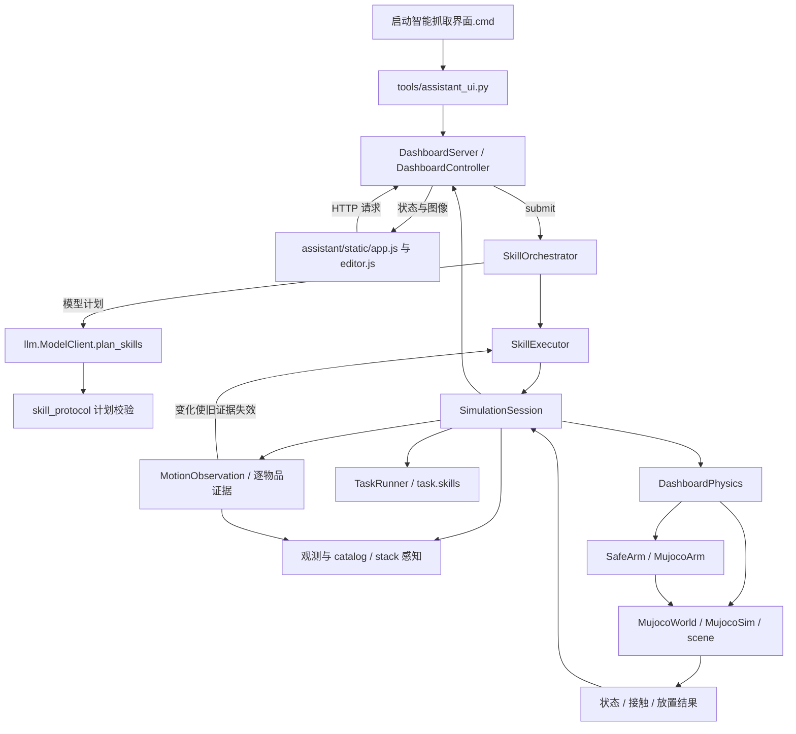

# Graphify 项目导航与使用说明

本图谱帮助查找“浏览器指令经过哪些模块才到机械臂”“观测、规划、执行分别在哪里”。当前主线是 `cube_task/assistant` 的网页 MuJoCo 抓取系统；原有 L1/L2 任务、ROS 相机、真机适配器仍保留独立入口。

## 先看哪里

| 需求 | 入口 |
|---|---|
| 看模块分群 | [社区总览](../../graphify-out/graph-overview.html)，142 个社区 |
| 查看源码关系图 | [交互图](../../graphify-out/graph.html)，5,004 个源码节点，默认按社区合并显示 |
| 查看静态结构报告 | [GRAPH_REPORT.md](../../graphify-out/GRAPH_REPORT.md) |
| 确认本次具体分析了哪些文件 | [scope.json](../../graphify-out/scope.json)，128 个 Python/JavaScript 源文件 |
| 查看解析质量和局限 | [health.json](../../graphify-out/health.json) |

上述数量描述已生成的图谱快照，不保证与后续修改的工作区同步。生成图谱本身只读取白名单源码，不搬动源码或改动抓取执行逻辑。交互 HTML 使用 Graphify 默认的公开 vis-network CDN 库；JSON 和 Markdown 可离线读取。

当前节点数超过 5,000，HTML 为便于浏览采用社区总览；要精确查询单个类、函数和调用关系，请使用下方命令或 `graph.json`。

## 当前网页的执行链



该图是按入口和源码调用核对后的导航图。HTTP 路由、运行时注入、闭环反馈不保证都能由静态 AST 自动连出；它们不能仅凭图谱最短路径判断。

| 阶段 | 建议阅读顺序 | 关键职责 |
|---|---|---|
| 启动与网页 | `tools/assistant_ui.py` → `assistant/server.py` 的 `DashboardController`、`DashboardHandler` → `assistant/static/` | 入口默认 `mujoco`，服务绑定本机；控制器管理任务、停止、场景修改与恢复 |
| 运动中状态更新 | `assistant/motion_observation.py` → `observation_policy.py` → `simulation.py` 的运动回调与 `server.py` 场景发布 | 管理实际 RGB-D、身份连续性、完整源测量、背景深度和逐物品失效；裁剪、支撑遮挡与真实移动分开处理 |
| 自然语言转计划 | `DashboardController.submit` → `SkillOrchestrator.run` → `ModelClient.plan_skills` → `skill_protocol.py` | 当前客户端支持 `plan_skills` 时进入技能编排；模型响应通过协议校验 |
| 技能执行 | `skill_execution.py` 的 `SkillExecutor.execute`、`_pick`、`_place`、`_move` | 检查计划版本、观测目标，执行抓取、放置、搬运；动作结果回到编排器 |
| 观测与操作会话 | `simulation.py` 的 `SimulationSession`、`observe`、`execute` | 管理场景、观测、停止、版本、动作执行，复用任务与感知层 |
| 物理桥接 | `physics.py` 的 `DashboardPhysics`、`_build`、`sync` | 构建 MuJoCo 场景并同步物体状态、支撑接触与桌面反馈 |
| 引擎与机械臂 | `sim/mujoco/engine.py`、`arm.py`、`world.py` | 时间步、控制器、运动、夹爪、对象姿态与速度 |

上表使用符号名避免行号随修改漂移；省略的共同前缀是 `ws/src/cube_task/cube_task/`。源码修改后应先更新图谱，再用查询结果的 `source_location` 定位。

## 物理、感知、ROS 的边界

`tools/assistant_ui.py` 默认选择 MuJoCo，也允许明确选择 `sim` 运动学模式。`SimulationSession` 内部构建的沙盒配置与 `DashboardPhysics` 连接当前网页；浏览器可视化状态与模型可用的观测对象分开管理。图谱能显示模块依赖，不能证明视觉识别精度或物理抓取成功率。

原任务入口 `tools/run_task.py` 通过 `tools/common.py` 组合相机、机械臂、感知和 `TaskRunner`。`camera/factory.py` 支持 `ros`、`file`、`sim`、`mujoco`；`robot/factory.py` 与 `robot/pyagxarm_arm.py` 保存真机路线。因此“仓库有 ROS/真机适配器”不等于“当前网页已连接真机”。

`piper_vision` 是独立的相机标定、坐标转换和 L1 检测包。它与 `cube_task` 的明确接点是 `perception/factory.py` 的 `L1 + perception.backend=l1_new` 条件及 `perception/l1_new.py` 适配器；当前沙盒从 `assistant/catalog_perception.py` 构建感知。请分别核对入口和配置，避免把两条视觉路线混为一谈。

## 安装与查询

本机已安装：

- Codex skill：用户 Codex 目录下的 `skills/graphify/SKILL.md`，同目录附带上游 references；重新加载后可被发现。
- 独立 Python 环境：用户 Codex 目录下的 `tools/graphify-venv/`，Python 3.11，`graphifyy==0.9.114`。这属于本机安装记录，其他机器需要单独安装。
- 上游：Graphify-Labs/graphify，`v8` 分支固定提交 `b582ad401aaef4378935ec6620e3b165ae8e03c1`；真实正文源为 `graphify/skill-codex.md`，通用正文源为 `graphify/skill.md`。

Skill 先通过 Codex 官方 `install-skill-from-github.py` 从上游 `graphify/` 安装，再采用该目录原样提供的 Codex 正文与 Codex references。未安装 Git hooks、云服务、MCP 连接或外部模型扩展。

在项目根目录打开 PowerShell：

```powershell
$graphPython = Join-Path $env:USERPROFILE '.codex/tools/graphify-venv/Scripts/python.exe'
$env:PYTHONUTF8 = '1'
$env:GRAPHIFY_BACKEND = 'none'
$env:GRAPHIFY_QUERY_LOG_DISABLE = '1'

& $graphPython -m graphify query 'DashboardController SkillOrchestrator' --depth 1 --budget 2000
& $graphPython -m graphify explain 'DashboardPhysics'
& $graphPython -m graphify query 'SkillExecutor' --context call --depth 1 --budget 2000
& $graphPython -m graphify path 'DashboardController' 'MujocoArm' --undirected
```

中文提问时同时附上类名或文件名，可避免关键词与代码词汇不匹配。`path --undirected` 适合查看关联，不代表真实调用方向；调用方向要看边的 `relation`、`context` 及源码。若输出提示预算截断，收窄到一个符号或增大 `--budget`。

## 更新图谱

```powershell
& $graphPython docs/architecture/build_graph.py
```

该脚本固定白名单：`ws/src/cube_task/cube_task/` 与 `ws/src/piper_vision/piper_vision/` 中的 `.py` 和 `.js`。它调用 Graphify 的本地 AST 提取、建图、分群、诊断、JSON/HTML 导出及清单保存；不执行或导入项目模块。为严格控制隐私范围，文件检查使用显式白名单，替代面向整个项目的通用发现流程。以后请用此脚本更新，避免无范围限制的根目录扫描。

排除内容包括 `.env`、密钥、`.git`、对话记录、Markdown 文档、测试、配置、HTML/CSS、模型、媒体、运行产物、第三方及其他 ROS 包。安装公开依赖时联网；本次图谱提取没有把项目内容发送到外部模型，也没有读取密钥值。Graphify 模型调用消耗为 **0 输入 / 0 输出 token**，不包含当前助手对话本身的用量。

## 如何解释结果

本次得到 **4,959 节点、13,933 边、158 社区**。核心枢纽包括 `Detection`、`SimObject`、`TaskRunner`、`SimulationSession`、`MujocoArm`；跨模块候选联系包括手持观察 `inspect_held()` 到放置观察 `safe_inspection_route()`。带 `INFERRED` 的边是解析器推断，需核查源码。

质量诊断明确记录：原始 AST 有 **1,414 条端点未解析的边、6 条自环**，简单有向图合并了 **769 条相同端点的边**。这些是静态解析与图表示的限制，不能直接认定为项目缺陷；完整原始调用关系、外部库、动态绑定、HTTP 与 ROS 通信可能无法由此恢复。JSON 中的置信度和来源位置应与源码一起使用。

分群使用默认安装可用的 **NetworkX Louvain**，没有安装可选 Leiden 依赖。社区名称由占比最高的源文件命名，可能重复；它们用于导航，不是已经验证的架构分层。`communities.json` 记录每群的原始 cohesion 分数与主文件。

图谱核对只检查入口、调用关系及边界，不构成物理场景或真机验证。项目运行结果、决策边界和速度测量见 [六物品闭环验证](../validation/2026-11-22-typical-tasks.md) 与 [决策与性能验证](../validation/2026-11-21-decision-and-performance.md)。Graphify 自带 benchmark 的 token 减少倍数属于内部估算，本说明不将它作为实际性能结论。
