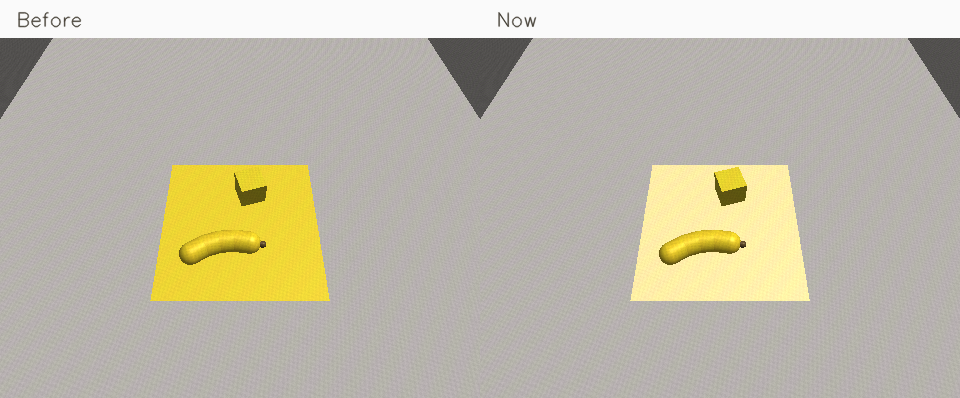

# 运动中增量观察、连续搬运与人工干预验证

由主助手直接处理，未使用子 agent。在线模型负责语义计划，RGB-D 提供位置，生产技能和 MuJoCo 执行并独立核验。物理真值仅用于摆场、使旧证据失效和审核结果，不用于生成抓取或落点坐标。

## 本轮发现

- 原网页第一步苹果没有进入闭合抓取，错误为 `unreachable release: y needs workspace margin`。命名区域初始规划走了较宽松的分支，之后该落点拒绝又把物品留在失败列表里，后续重复返回 `not attempted (measure again)`。
- 观察复用要求相机姿态不变、图像时间很近，机械臂一动便无法复用。原网页预览虽在刷新，识别场景没有在运动中持续写回控制器。
- 人工干预递增全局环境版本，旧流程把整套语义技能都取消。并未区分“另一个目标已被人工放好”与“当前抓取/释放路径已经不安全”。
- 香蕉在不同腕部视角下，拟合中心有约 11 mm 差异；审核还须覆盖物品库完整尺寸。边缘落点可通过独立物理检查，却无法通过保守的相机完整轮廓检查，随后模型再抓一次。
- 放置区有多份来源，单改几何世界不足以改变 MuJoCo 的 `info.zones` 与规划覆盖配置。
- 叠放后，完整保留的下层黄块点云被压成 XY，误挡高于它的梨夹爪。只清点云会掩盖此问题；本轮保留完整障碍，并按最深抓取、最大开度和最大允许倾角计算指尖最低高度。仅有完整 RGB-D 与可靠高度的低物体可退出局部夹爪检查，全局路径仍保留它；不完整、高度未知或同高度物体不放行。
- 梨和支撑在图像里粘连成高轮廓时，估计的底部可能落在桌面。它不能仅凭 XY 接近替换掉已知的完整下层物体；明确物理移动和实际看到背景仍可使旧记录失效。
- `pick → place` 交接中的静止观察会清空界面阶段名，原运动采样仅据阶段名判断持物，导致手里的梨被再次加入障碍。现在优先使用成功抓取建立的实测持物记录；释放后退阶段恢复对已放下物品的正常识别。
- 人工把另一件物品放到旧临时落点后，原搬运入口仍只重找通往旧悬停点的路径，搜索更久也无法解决端点已被占用。现在抬升后的安全停点先调用同一套 RGB-D 落点规划，选出新落点和完整受检路线，再继续搬运。
- 未定位物品的整桌排斥体必须同样约束显式主动观察。寻找这类视角时，候选生成器使用已测障碍高度，并按候选姿态计算持物和双指的完整垂直包络；不再要求平放香蕉为半个长度额外抬升。每段实际扫掠、倾角、可达性和未知范围检查仍保留；原包围球接口也保持兼容。
- 为抓取补看源物品时，两个源视角不一定覆盖叠放底座。确认上层抓取几何后，允许补充最多四个按底座位置排序的局部视角，保留已经测得的上层证据；不重复扫描上层来寻找下层。

## 最终实现

1. `MotionObservation` 在仿真所有者线程限频采集实际 RGB-D，不新增操纵相机的后台线程，不为采样单独移动机械臂。运动帧和动作间隙帧立即更新网页目标列表，保留各物品自己的证据；相机移动不等于物品移动。
2. 手动移动、非预期物理运动、确知的可见目标消失和身份歧义都会使相应证据失效。裁剪或遮挡不凭空删除旧障碍，也不能确认一个已失效目标的新位置。停止、旧帧和跨版本混合帧不能产生新完成证据。
3. 原本可靠、未变化的基座坐标测量可继续用于接触与碰撞规划。抓起时撤销该物品原位置的完成证据，放下后需要新的相机测量与独立物理检查；轴对称直立梨子的不稳定图像主轴不强迫重扫。
4. 在抬升后的安全边界处理人工干预，重新检查持物完整扫掠路径。尚未看到新位置的物品用桌面范围的不确定排斥体约束路径，高度使用物品的高度先验，不能把香蕉的长度当高度。非预期物理变化仍中止旧路径；下降、释放与执行中的旧搬运路径不直接放行。
5. 剩余步骤保持语义目标，每步重新绑定当前测量。全部原目标已由新状态满足时立即做完整审核，通过后提前跳过剩余技能；不会因为还有旧计划步骤而继续搬运。
6. 命名区域初始规划与后续放置采用相同的严格轮廓、工作空间和退出条件。落点拒绝不会永久禁止下一次独立搬运重试。搜索增加有限的空隙中部候选；缺少视线时瞄准已找到的几何空位，而不是反复瞄准被占住的旧落点。
7. 三个网页色区均为 **30 cm × 30 cm**，几何、规划配置、物理建场信息与显示保持一致，物理场景重建后也不回退。命名区域规划额外保留 **15 mm** 跨视角定位余量；最终相机完整轮廓的原有 5 mm 要求不变。L1 原赛场配置不改。
8. 网页人工干预使用独立的环境修订号，相机更新画面不会使拖动操作过期。模型提示说明增量更新能力，减少每件物品前后的机械式观察、验证指令；对缺测和具体失败仍保留补充观察及人工审批。
9. 网页区域改用较浅的红、绿、黄，保留物品本身的主色调；实际 RGB-D、MuJoCo 材质、三维视图和俯视摆场一致。香蕉及黄块位于黄区中央、跨黄区边缘的带噪 RGB-D 检测有专门回归；原 L1 配色不改。下图由实际相机渲染器生成：



## 验收方式

通过 `cube_task.tools.assistant_bench` 使用实际在线模型、生产控制器、RGB-D 与 MuJoCo 顺序验证：

1. 固定随机种子 7 打乱六件物品，再全部放回默认区域。
2. 实际将梨放在黄块，再命令黄块回黄色区；须先处理上层梨子。
3. 实际叠放梨到黄块，再让全部物品回默认区域。
4. 随机六件物品，全部回抓取区。
5. 香蕉和梨子初始均在抓取区；首件抬起时，通过生产人工干预接口把另一件移到红区、占用原临时落点。检查首件改选可用位置、另一件零重复抓取、两件最终通过全部审核。

```powershell
$env:PYTHONPATH='ws/src/cube_task'
& '.venv-physics/Scripts/python.exe' -m cube_task.tools.assistant_bench `
  --cases 1,2,3,4,5 --seeds 7 --timeout 900 `
  --output local_validation/typical_tasks_20261122/incremental-replay
```

统计包含模型轮数、实际搬运、失败/暂缓、采集帧、局部/全场扫描、途中帧及证据复用、人工干预与逐件物理结果。`local_scans` 不包含持物观察路径的运动，不能单用该数宣称完全没有相机调整。原始对话、点云、检查点和诊断输入留在忽略目录，不提交公开仓库。

## 回归与验收记录

五类验收均已通过相机审核与逐件独立物理核验。第 2 类采用 `incremental-acceptance-v14`，其余采用 `incremental-acceptance-v17`；后续修改集中在人工干预入口及缺失底座的局部视角补充，没有改变第 2 类实际执行的普通搬运路径。脱敏计数见 [incremental-task-results.json](incremental-task-results.json)。

| 场景 / 阶段 | 耗时（秒） | 模型轮数 | 实际搬运 | 失败 / 暂缓 | 全场扫描 | 局部扫描 | 静止取帧 | 观察移动 |
|---|---:|---:|---:|---:|---:|---:|---:|---:|
| 1 随机六件回默认区 | 305.28 | 1 | 5 | 0 / 0 | 0 | 5 | 7 | 2 |
| 2 先把梨叠黄块 | 147.33 | 1 | 1 | 0 / 0 | 0 | 1 | 2 | 1 |
| 2 再把黄块送黄色区 | 222.00 | 1 | 2 | 0 / 0 | 0 | 2 | 4 | 0 |
| 3 先把梨叠黄块 | 162.31 | 1 | 1 | 0 / 0 | 0 | 1 | 2 | 1 |
| 3 再把六件回默认区 | 125.97 | 1 | 2 | 0 / 0 | 0 | 2 | 2 | 0 |
| 4 随机六件回抓取区 | 310.45 | 1 | 4 | 0 / 0 | 0 | 0 | 4 | 0 |
| 5 抬起首件时人工归位另一件 | 233.75 | 1 | 1 | 0 / 0 | 0 | 0 | 6 | 4 |

上述阶段均为 **零掉落、零额外模型恢复**。第 1、3、4 类最终均审核六件物品；已经在目标区内的物品正确跳过，因此实际搬运次数不一定是六次。第 2 类先获一次临时腾挪授权，再取下梨并搬黄块；隔离测试自动点击授权，生产网页仍保留人工审批。第 5 类只抓香蕉，人为放好的梨零次重复抓取；原落点 `[0.145, -0.315]` 被占用后，香蕉改选 `[0.25, -0.31]`，两目标通过后提前结束。

这是固定种子 7 和声明布局的回放结果，不代表任意布局的成功率。任务 5 虽没有独立扫描，仍有四段受检局部观察移动，不能称为“全程没有补看”。任务 1 也仍有局部扫描；本轮消除了重复全场重扫及无变化物品的普遍抓取前重确认，没有取消必要的接触、支撑与落位证据检查。

当前重点回归两组共 **211 项通过**（文件不重叠）：主动观察 / 放置路径 / 持物入口 / 抓放几何 / 停止行为 116 项，联合叠放观察 / 扫描推进 / 目标扫描 / 源观察 95 项。运动观察、持物采样和实际 pick→place 的 51 项回归也通过；其他早期大集合不与这些数字相加。界面通过干预 67 项断言、技能 140 项断言、放置 42 项断言及刷新性能检查。新增香蕉与黄块在黄区中央、边缘的真实带噪 RGB-D 配色回归；对应感知测试文件共 26 项通过。

扩大回归时另发现旧几何测试把已经更改的默认参数当成固定值，现改为显式指定测试参数；停止测试也区分“已经松手”与“已完成退出和最终核验”，中途停止不能计作已审核完成。这些更新没有改动运行参数或放宽完成条件。

下列历史负例保留用于说明修复依据，不能替代上述验收或被隐藏为一次顺畅运行：

- `incremental-capacity30`：人工干预后最终成功，但有两次无效搬运尝试、三轮模型，不属于顺畅完成。
- `incremental-entry-observation`：把观察前置仍失败，整桌未知位置排斥体覆盖了偏低的起点；没有删去该障碍来通过。
- `incremental-high-carry`：提高实际抬升的最低余量后，干预测试一轮模型、零动作失败、零掉落，另一件零重复抓取；有三段受检观察移动。
- `incremental-acceptance-v4`：第一类最终通过，两轮模型、两件因中途识别丢失被暂缓；第二类两个阶段通过，搬黄块前实际先移走梨；第三类最终通过但有多轮恢复。第四类发生观察停靠点余量不足，已中止并保留现场。
- `incremental-acceptance-v5/v6`：分别暴露未知碎片被误建为完整移动物体、分割漏检被误当消失的问题。中止后修复，未将中止任务计作通过。
- `incremental-acceptance-v7`：第四类四次实际搬运完成，梨与黄块正确跳过，零掉落；红块因身份与落位补看共三轮模型，因此仍不计为顺畅完成。随后叠放阶段通过，后续因启用性能与身份跟踪修复而中止。

物理 `dropped` 原始事件仍保留，同时单列 `unsupported_drops`。例如第一类早期的两次事件发生在梨的闭爪接触建立阶段，当时下方支撑仍为桌面；没有把它们计作搬运途中无支撑掉落，也没有删除原始事件。

- `incremental-acceptance-v9`：第四类全部物理通过，红块与梨不再因回调合并被暂缓，零掉落；香蕉首次放置观察预算超时，第二轮补充观察后完成。整项 567.02 秒、两轮模型，仍保留一次失败。其后修正当前目标抬起时误清全部背景帧的问题，再运行最终验收。
- `incremental-acceptance-v11/v12`：叠放成功，但后续源抓取被错误的 XY 邻物投影拒绝；中止后以完整缓存和点云离线复现，修正高度判断。
- `incremental-acceptance-v13`：第三类一轮通过；第二类临时放置又暴露持物阶段交接导致自身进入障碍列表，保留失败后修正。
- `incremental-acceptance-v14/v15`：第二类通过；人工干预后仍搜索旧端点或耗尽未知物体视角预算，未计作顺畅完成。
- `incremental-acceptance-v16`：人工干预最终完成，179.67 秒、两轮模型、一次失败、零掉落；该轮的主动观察未统一未知体积约束。随后补齐约束和姿态包络，再以 v17 一轮、零失败通过。最终更完整的安全检查也增加了本次实际耗时，不能以减少模型轮数宣称所有场景都更快。

## 额外修正与速度依据

- 搬运入口、放置复核、恢复和技能静止观察均采用相同的增量合并规则；不会在主观察器保留旧完整目标后，又被下游回调用新裁剪覆盖。
- 抬起当前目标只撤销它原位置的物品证据，保留未变化场景的背景深度。外部移动仍撤销旧背景；放下物品后也会清理可能仍显示空位的旧帧。背景帧不产生物品完成证据。
- 上层梨与下层黄块按不同高度层关联；上层的有效检测不会仅因 XY 相近替换掉下层身份。
- 经过完整几何确认的旧物品，只有深度图确实看到原表面后方，才会因当前分割缺失而删除。遮挡、深度洞和仍在原深度的表面不算消失；明确的人为移动和实际物理位移仍立即撤销旧证据。
- 未分类的碎片保留为实测障碍，不创建一个假想的完整移动物体。真实已移动但未定位的物体仍保留完整的不确定排斥体。
- 以未变化的 RGB-D 身份和释放后的测量运动预测关联新图像。只有唯一位置、高度匹配并且新点云通过该类别完整性检查时才沿用身份；裁剪、歧义和已发生干预的物品不能据此确认完成。释放预测单独不构成相机证据。
- 观察路径的停靠点额外保留 20 mm 离障余量，避免到达时采用较细路径采样能通过、下一段换用较大采样余量却无法离开的情况。完整碰撞检查保留。
- 对实际执行进程做 12 秒、50 Hz 采样：运动中观察约占采样 54%，其中生成相机画面约 40%；界面状态生成约 26%；物理积分约 11%。这些是该时间段的函数累计采样份额，不能当成所有任务的固定比例。
- 网页状态限频由 20 Hz 改为约 6.7 Hz，仍高于网页常规 5 Hz 轮询；阶段、干预和观测事件立即发布。运动图像采用至少 1.25 秒仿真时间、且上一帧处理结束后至少 0.45 秒的间隔，关键边界可强制取帧。未减少物理积分、接触精度或停止检查。
- 固定桌面的已测基座平面短暂复用 3 秒；每帧物体深度和分割仍重新计算。区域归属在一次计算中复用同一份轮廓点，结果与逐区域重算相同。

最终单次运行耗时会同时受到模型响应和本机负载影响；独立观察移动、模型轮数、失败、实际搬运次数和逐件物理结果一并报告。

## 当前服务启用核对

源代码提交 `4076281` 已同步到用户运行目录并启用 `http://127.0.0.1:8767/`。启用前备份的三件方块、颜色、位置、速度及对话均予保留；三个区域均为 30 cm，服务接口确认使用新的浅色材质、增量观察组件和正常相机预览。

实际发送一次只读识别问题，产生一次在线模型请求；接口观测到 13 个不同长度的助手文本版本、20 个相机更新时间，结束后状态为 ready、空夹爪，三件物品位置未发生有意义的变化。前端文本更新和操作监听器另由 JavaScript 界面测试验证。

**目视复核限制：** 当前聊天的浏览器控制不可用；桌面浏览器自动化又因无法核实既有页面网址而被安全机制终止，因此没有完成新版网页的目视检查。已停止浏览器操作，没有绕过该限制。上述服务接口、模型回复增量、相机输出和前端测试分别保留证据，不能把它们写成已完成浏览器目视复核。
