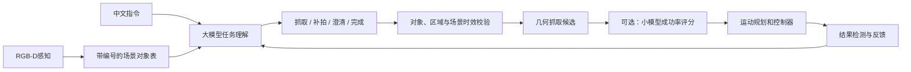

# 人工智能创新方案：语言任务理解与稳定抓取

日期：2026-11-14。用户偏好：允许在线模型 API，优先快速验证。本文为可选择的研究方案，尚未实现这些扩展，也未调用付费模型服务。

## 1. 最推荐的分工

大模型理解“要什么、现场有没有候选、选哪个、放哪里、失败后做什么”；RGB-D 与几何程序确定米制位置；运动规划与控制器执行动作。若要提高稳定性，用小模型学习“哪种可行抓法更可能成功”。



现阶段可先用已有 `sim` 验证语言交互与选择逻辑；稳定抓取学习必须转到 MuJoCo/Gazebo 物理后端。课题最终运动链仍需补齐 MoveIt2 与 Gazebo 接入。

## 2. 当前项目的 AI 基础到底有哪些

| 能力 | 当前实际情况 |
|---|---|
| 默认 L1 识别 | HSV 颜色与深度几何规则，无神经网络 |
| L2 分类 | KNN，有已有训练/采集工具 |
| YOLO | 支持 ONNX 推理、训练/导出工具；权重需另备 |
| 自然语言任务 | 当前未实现；`docs/需求分析.md:11` 写明 L3 已删除 |
| `--targets` | 只接受配置中的标签与顺序，不理解中文、关系、数量或条件 |
| `operator.py` | 开始、中止、急停按键 |
| 在线视觉更新 | `task/live.py` 更新剩余场景，不修改正在执行的轨迹，不是防滑伺服 |
| 稳定抓取控制 | 有规则抓取、宽度反馈、力参数和失败检查；没有已训练的低层控制策略 |

现有接口很适合增加决策层：

- `task/runner.py:977` 的 `ready_for_pick()`：准备机械臂状态。
- `task/runner.py:1004` 的 `observe_once()`：获取一次场景检测。
- `core/types.py:90` 的 `Detection`：类别、分数、框、mask、基座位置、尺寸、朝向等。
- `task/runner.py:1027` 的 `pick_detection(det, zone_name, neighbors, ...)`：对选定实例执行一次抓放。

调用这些方法仍需要先创建会话、连接/使能相应仿真后端、完成准备与自检；它们不是可以脱离运行环境直接调用的在线 API。

## 3. 方案 A：场景约束的大模型任务规划——最快落地

### 用户能看到什么

输入：“先把红色方块放到红色区域，再抓黄色方块；如果看不清，换个角度看看。”

系统先观察并得到带编号对象，再让大模型选择动作。每次动作后更新场景，将成功、未检测到、不可达、抓空等结果回传给模型，由模型决定下一步。

第一版可以只发文本对象表给在线模型，不必先部署本地大模型。对象表来自已有视觉结果，例如：

| 编号 | 类别 | 相对描述 | 感知状态 |
|---|---|---|---|
| obj_1 | red | 当前视野左侧 | 有可靠深度 |
| obj_2 | green | 当前视野中间 | 有可靠深度 |
| obj_3 | yellow | 另一观察位 | 位置需要刷新 |

这些是格式示例，不是本次场景的真实编号或位置。像“左边”必须明确是图像左侧、机器人基座方向还是用户视角；第一版可固定为当前相机图像左侧，避免歧义。

模型只返回结构化动作，例如：

```json
{
  "scene_version": 7,
  "action": "pick_place",
  "object_id": "obj_1",
  "destination": "zone_red"
}
```

其他动作可限制为 `observe_again`、`ask_clarification`、`finish`。动作结果必须由程序校验，再映射到已检测的 `Detection` 与已配置的区域。

### “是什么、有没有、在哪里”如何回答

| 问题 | 实际依据 |
|---|---|
| 要抓什么 | 大模型解析中文指令、属性、顺序与条件 |
| 是什么物体 | 现有识别器，或后续方案 B 的视觉语言模型/开放词汇检测 |
| 有没有 | 观察结果与扫描覆盖状态；分成“已观察到”“当前未观察到”“尚未充分观察” |
| 选哪一个 | 大模型依据对象编号和关系选择，歧义时澄清或复观测 |
| 在哪里 | 框/mask 内深度反投影与坐标变换，输出基座系位置 |
| 能不能抓 | 夹宽、深度质量、邻物、IK、碰撞与可达性检查 |

不能把“本次没识别到”解释为物体绝对不存在；遮挡、视野不足和分类器漏检都可能造成缺失。对外回答应限定为“当前已观察区域未发现”。

### 最小新增内容

1. 中文指令输入和在线模型 API 调用。
2. 将检测结果导出成对象表，增加本次观察的对象编号和场景版本。
3. 结构化输出校验与对象/区域映射。
4. 调用既有单物体抓放接口，动作后重新观察。
5. 保存指令、模型输出、观测依据、实际执行结果和耗时。

如果需要“换个角度”，还要给公共观察接口增加 `view_id` 等参数，并仅允许选择已配置的观察位；将当前视点与覆盖状态写入对象表。现有 `observe_once()` 默认调用视点 0，重复调用只能在同位补拍，不能直接实现指定视点切换。底层多视点观察已有基础，但需要把它暴露给新的决策层。

`Detection.track_id` 的存在不代表当前已实现可靠的跨视点持久身份。最小版本使用“场景版本＋本次对象编号”，新图像到达或物体移动后更新编号；执行前重新核对。只把类别转成 `--targets` 不够区分两个同类实例。

### 如何做成可评价的创新

单次聊天接口连接机械臂主要是系统集成。更有研究价值的新增点是：**场景约束、缺失目标处理、按需补拍、执行反馈驱动的重规划**。

对照组：

- 关键词＋颜色/物体字典的规则解析。
- 大模型仅解析指令。
- 加场景对象表。
- 再加输出校验与执行前复核。
- 最后加失败反馈、补拍与重规划。

测试覆盖：同义表达、指令顺序、条件句、两个同类目标、不存在/被遮挡目标、模糊表达、目标在动作后移动。默认 L1 每色一个方块；要评价“左边那个红色方块”等指代表达，需要增加同色实例的场景，不能只在三个唯一颜色上测试。

指标：指令解析正确率、目标实例选择准确率、未观察目标误执行率、结构化输出有效率、端到端任务成功率、复观测次数、模型调用次数与额外时延。模型自报的置信度不能直接当成校准概率。

### 开源参考

- Qwen3-VL：https://github.com/QwenLM/Qwen3-VL ，仓库有 API 入口和图像定位示例；可使用兼容任务的在线服务快速验证，不需要先下载权重。
- Qwen 图像定位示例：https://github.com/QwenLM/Qwen3-VL/blob/main/cookbooks/2d_grounding.ipynb 。
- SayCan：https://github.com/google-research/google-research/tree/master/saycan ，借鉴“语言意图＋技能可执行性”的分工；目录提供 pick/place notebook。它不是已适配 PiPER/ROS2 的现成安装包。

## 4. 方案 B：让模型看图并按文字找物体——更直观，难度中等

当指令出现当前分类器不支持的“杯子、盒子、某个左侧物体”时，单靠对象表不能创造新检测结果。可以增加文字指物定位。

两种实现方式：

1. **在线 VLM**：RGB 图＋中文指令 → 目标框或目标点 → 深度实例关联 → 三维定位。Qwen3-VL 是开源参考。
2. **文字检测流水线**：大模型生成检测短语 → GroundingDINO 给框 → 必要时 SAM2 给 mask → 原有深度几何计算三维位置。

优先先试在线 VLM 或“现有检测框加编号→VLM选择编号”，再根据定位失败情况引入 GroundingDINO/SAM2，控制依赖数量。

VLM 输出的框可能使用缩放后图像或归一化坐标，必须按对应模型文档还原到原始 RGB 分辨率。二维输出不能直接当作米制三维位置；也不能在框包含多个物体时直接取框中心深度。

当前 `detector_onnx.py` 的框主要用于给深度实例赋类别，新增文字检测器还需要一个适配层，处理框/mask 与原有实例的关联。透明/反光物体即使被模型识别，RGB-D 也可能无可靠深度；首版实验优先用不透明物体。

对照：固定类别识别、文字框＋中心深度、文字框＋几何实例关联、mask＋鲁棒深度。指标：文字目标检出率、缺失目标假阳性率、框/mask IoU、三维定位误差、首次抓取成功率、API/推理时延。

开源参考：

- GroundingDINO：https://github.com/IDEA-Research/GroundingDINO ，预训练文字条件目标检测，支持 CPU 模式但速度需本机评估。
- Grounded-SAM-2：https://github.com/IDEA-Research/Grounded-SAM-2 ，文字检测与分割组合参考。
- SAM2：https://github.com/facebookresearch/sam2 ，分割组件。

这些组件不需要第一版全部接入。只有当框不够精确、实例混淆明显时，再增加 mask 模块更合适。

## 5. 方案 C：小模型学习哪种抓法更稳——推荐作为主要算法实验

### 直观解释

现有 `GraspPlanner.plan()` 最终返回一个抓法。此方案需要复用现有几何规则，新增少量候选生成、可行性过滤与学习评分，选出更可能抓稳并搬运成功的一个。第一版用逻辑回归、随机森林或梯度提升树，不必一开始训练神经网络或强化学习。

例如，对同一目标生成少量候选：略微不同的抓点、夹持高度和角度；后续再加入有限档位的抬升/搬运速度、夹持力。先从 5–10 个候选开始，用 IK、夹宽和碰撞条件过滤后评分。

### 数据怎么来

在 MuJoCo 或 Gazebo 中执行候选，自动记录特征和物理结果。先用几百次尝试做小规模可行性验证，再根据学习曲线、失败覆盖和独立测试表现决定是否扩充数据，不能预先保证少量样本足够。

| 类型 | 示例 |
|---|---|
| 执行前可用的物体特征 | 长宽高、长宽比、夹持截面宽度、几何中心、深度有效率、遮挡程度 |
| 候选特征 | 抓点偏移、抓取角、下探高度、夹宽余量、邻物间距、可达性余量 |
| 后续可扩展控制参数 | 计划夹持力、抬升/搬运速度、加速度限制 |
| 标签 | 是否抓起、是否保持稳定、途中是否掉落、最终是否正确放置 |

真值质量、摩擦系数可以用于离线随机化和评分；如果部署时无法测量，就不能直接作为模型输入。应按场景/物体形状分训练与测试，避免同一场景稍改抓点就随机分到两边。

### 稳定标签必须来自物理状态

可以预先固定一个验收规则，例如“物体抬离桌面至少 3 cm，持续保持 1 秒，并在规定搬运轨迹中未脱落”。阈值是待实验确定的协议示例，所有对照组要一致。

不要只用 `PickResult.ok`：它是任务程序认为成功；也不要把人工注入 `drop` 或 `grasp_miss` 故障当作真实摩擦成败。应从物体运动、接触、相对夹爪位姿变化与最终真值生成标签。

现有可复用位置：

- `perception/grasp.py`：现有几何候选基础。
- `task/runner.py`：把候选选择接入单次抓放。
- `task/skills.py`：抓取高度、动作顺序和固定的夹爪力调用。
- `sim/mujoco/run.py`：物理事件监测与最终真值。
- `sim/mujoco/arm.py:825`：已支持夹爪 `force`，当前 MuJoCo 力限制为 0.5–3.0 N；`skills.py` 通常按任务设置固定力，要逐物体自适应时还需小幅接口扩展。该范围是当前仿真后端定义，不能直接解释为真机控制标定。

具体接入应在 `runner.py:840` 附近，把当前一次 `planner.plan(det)` 改成“生成候选→检查→评分→选一个”。`pick_detection()` 接收的是 `Detection`，内部仍会重新规划；不能在外部选好 `GraspPlan` 后把它直接传给该方法。

### 如何证明模型有用

对照：当前完整规则规划器、随机挑可行候选、人工设计评分、学习评分。

消融：去掉深度质量、去掉邻物信息、去掉几何/可达性特征；只选抓法对比同时选速度/力；有无物理参数随机化。

指标：首次抓取成功率、稳定保持率、搬运掉落率、重试次数、完整任务成功率和推理/规划耗时。正常 L1 已经容易达到 3/3，需要在姿态变化、贴靠、不同尺寸、物理参数变化等条件下评价，而不能只重复同一简单场景。

若学习夹持力，要同时评价力的大小或加入用力代价，防止策略总选最大力。当前刚体模型不能充分描述易碎物体的破损与柔性变形，因此“夹得住”不能直接证明“不会夹坏”。这里的稳定性评价是保持与搬运成功，不是控制理论上的稳定性证明。

### 开源参考

- scikit-learn：https://github.com/scikit-learn/scikit-learn ，最容易实现小模型评分与概率校准。
- GG-CNN：https://github.com/dougsm/ggcnn ，从深度图生成抓取质量、角度、宽度的参考；可作为学习抓取基线。
- GR-ConvNet：https://github.com/skumra/robotic-grasping ，从图像预测抓取配置的参考。

GG-CNN/GR-ConvNet 是旧研究项目，模型输入、依赖和相机裁剪都要适配；它们预测的是抓取候选，不能直接保证当前夹爪的摩擦承载能力。首版用 scikit-learn 的环境成本更低。

## 6. 如果真想让机器学习直接控制稳定抓取

需要区分三个层次：

| 层次 | 学什么 | 难度与建议 |
|---|---|---|
| 抓取候选评分 | 在已有可行方案中选抓点/角度/高度 | 低到中，先做 |
| 夹持参数选择 | 根据感知特征选择夹持力、开口、抬升速度 | 中，需物理成败数据与参数接口 |
| 反馈闭环控制 | 根据接触力、物体相对运动等连续调整夹爪或机械臂动作 | 高，需观测、控制周期、延迟与稳定性设计 |

如果选择强化学习，可用 Gymnasium 封装 MuJoCo 环境，并参考 Stable-Baselines3 的 PPO/SAC。但当前项目没有强化学习环境，需要新增 reset/step、观测、动作、奖励、终止条件、随机化和基准评估。

相对可控的后续版本是“保留既有规划，仅让策略输出有界的夹爪力/小位移修正”，不直接学习六关节全动作。仍需要合适的接触/相对运动反馈，训练成本比监督评分明显更高。

开源框架：https://github.com/DLR-RM/stable-baselines3 。它提供算法，不是 PiPER 已调好的抓取策略。

在线大模型 API 有网络延迟，适合按任务/动作事件调用；不适合放进需要连续反馈的快速控制循环。大模型任务规划与机器人低层稳定控制是两个研究层次。

## 7. 推荐最终组合

优先选择：**A 完成自然语言交互与反馈闭环，C 作为提高抓取成功率的主要算法实验**。只有固定类别识别明显限制任务时，再增加 B。

可用总题目：“基于视觉语言任务规划与学习型抓取评价的机械臂自主抓取系统”。与原课题结合时，保留 MoveIt2、RGB-D 和 Gazebo 平台作为系统基础。

最小交付顺序：

1. 复现 L1，固定当前检测、坐标与抓放基线。
2. 加“指令＋对象表→受约束任务”，先做单目标和缺失目标处理。
3. 接入课题的 MoveIt2/Gazebo 自动执行链，验证物理夹取。
4. 采集候选抓法的物理成败数据，训练小模型。
5. 做语言理解和抓取稳定性两组独立实验，最后测试端到端组合。

只调用一次大模型、换用一个现成网络、或者“使用了机器学习”都不足以证明方法新颖。可把贡献明确落在场景约束/反馈机制和学习评分的设计，并通过同场景对照与消融证明改进。本次未进行文献新颖性检索。

## 8. 参考核验范围

本次已在线核对 Qwen3-VL、GroundingDINO、Grounded-SAM-2、SAM2、scikit-learn、GG-CNN、GR-ConvNet、Stable-Baselines3 的公开仓库地址，读取了部分官方说明；SayCan 目录及 notebook 地址也已核对。上述仓库尚未安装到当前项目，没有进行模型精度、API 时延或 PiPER 兼容性测试。
