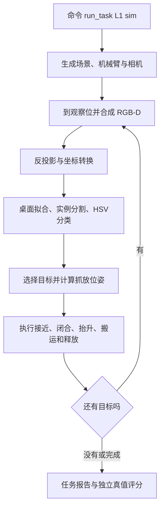

# 项目文件导览与 L1 复现

日期：2026-11-14。主仓库提交：`ed5912f`。本说明对应 `D:\大四上\智能车项目` 当前源码；人工智能扩展方案见同目录《人工智能创新方案.md》。

## 1. 先理解项目的分层

可以把项目理解为：相机拍照 → 视觉程序识别并算位置 → 任务程序决定抓谁 → 抓放规划计算末端位姿 → 机械臂接口执行 → 记录结果。

当前默认 L1 用合成 RGB-D 和运动学机械臂完成这条链。它无需 ROS、MoveIt 或 Gazebo。后续课题的 ROS/Gazebo 集成是在现有模块外补齐接口，不等于重写整个项目。

| 目录/文件 | 作用 | 第一次是否需要关注 |
|---|---|---|
| `README.md` | 上游总说明，包含比赛背景、安装、仿真和已知问题；部分历史描述可能过时 | 浏览 |
| `仿真复现与课题路线.md` | 前一轮审查、MuJoCo 安装启动、Gazebo 主平台路线和实验指标 | 需要 |
| `项目文件导览与L1复现.md` | 当前文件职责和本机 L1 复现操作 | 需要 |
| `人工智能创新方案.md` | 大模型任务理解、文字定位、小模型抓取评分方案 | 后续选题 |
| `operate.md` | 原团队真机操作备忘，不是 Windows 仿真入口 | 暂缓 |
| `schedule/` | 原比赛工作清单 | 暂缓 |
| `ws/` | ROS 工作空间；其中主任务也可作为普通 Python 程序运行 | 需要 |
| `ws/src/cube_task/` | 主任务项目目录，运行命令时进入这里 | 最重要 |
| `ws/src/cube_task/cube_task/` | 真正的 Python 源代码包 | 最重要 |
| `ws/src/piper_vision/` | 独立视觉与标定包，含另一套可选 L1 检测器 | 按需 |
| `ws/src/agx_arm_ros/` | 官方机器人描述、ROS 驱动、MoveIt 配置 | ROS/Gazebo 阶段 |
| `ws/src/handeye_calibration_ros/` | 官方手眼标定子模块占位，尚未初始化 | 纯仿真不用 |
| `third_party/pyAgxArm/` | 真机 CAN SDK 子模块占位，尚未初始化 | 纯仿真不用 |
| `local_assets/mujoco_menagerie/agilex_piper/` | 已下载的 MuJoCo PiPER 模型、材质和网格 | 物理仿真用 |
| `local_validation/` | 本次复现的日志、图像、报告、测试输出和缓存 | 查看结果 |
| `.git/` | 版本管理数据 | 不手动改 |
| `.gitmodules` | 子项目地址与所在目录 | 按需 |
| `.gitignore` | 忽略缓存、模型训练产物等的规则 | 按需 |

特别容易混淆：外层 `ws/src/cube_task` 是项目目录，内层 `cube_task` 是 Python 包。`python -m cube_task ...` 应在外层运行。

## 2. 主任务项目中的配置、模型和脚本

以下位置均从 `ws/src/cube_task/` 开始。

| 文件/目录 | 做什么 |
|---|---|
| `config/default.yaml` | 默认机械臂、相机、感知、抓放、任务、日志参数；最常改的配置 |
| `config/site/local.yaml` | 原现场的设备/感知覆盖配置，包含可选 `l1_new` 开关 |
| `config/site/tasks.yaml` | 现场类别、顺序与类别→放置区映射 |
| `config/site/poses.yaml` | 现场观察位、放置区和工作区域 |
| `config/site/colors.yaml` | 现场 HSV 颜色区间 |
| `config/site/extrinsics.yaml` | 现场相机外参 |
| `config/site/*.bak_*` | 历史配置备份，不是自动启用的配置 |
| `config/examples/` | 现场配置模板 |
| `config/motion.yaml` | 单独使用 `motion_ctl` 时的运控配置 |
| `config/rviz/camera.rviz` | 相机调试时 RViz 显示布局 |
| `models/knn_model.npz` | 已保存的 KNN 分类器，主要用于果蔬任务 |
| `models/knn_model_report.json` | KNN 训练/留一法报告，不等于独立测试集精度 |
| `models/*labels.txt` | 检测器类别名称；存在标签文件不代表 ONNX 权重也已包含 |
| `models/README.md` | 模型使用说明 |
| `scripts/mujoco_run.sh` | Linux MuJoCo 环境包装入口 |
| `scripts/moveit_rviz.sh` | 上游独立 MoveIt/RViz 调试入口，部分路径写死 Humble |
| `scripts/run_L1.sh`、`run_L2.sh`、`start.sh` | 比赛现场真机任务入口 |
| `scripts/can_up.sh`、`arm_check.sh` | 真机 CAN 配置与机械臂检查 |
| `scripts/camera*.sh` | 真实相机启动/检查 |
| `scripts/handeye.sh`、`capture_dataset.sh` | 现场外参与数据采集 |
| `scripts/_env.sh`、`_task.sh`、`env.sh` | 脚本共享环境和调用逻辑 |
| `docs/` | 配置、运控、仿真、YOLO、上机等专题文档 |
| `test/` | 自动测试，通常以被测功能命名，不是主程序 |
| `package.xml` | ROS 包名与 ROS 依赖声明 |
| `setup.py` | Python 打包和工具入口登记；没有声明全部运行依赖 |
| `setup.cfg` | ROS 安装后的脚本放置规则 |
| `resource/cube_task` | ROS 查找包使用的标记文件 |
| `__pycache__/`、`.pytest_cache/` | Python/测试缓存，不是源代码 |

默认 `--mode sim` 不读取 `config/site/`。只有显式加 `--site` 才合并这些现场覆盖参数；第一次复现不要加它。

## 3. 主包 Python 源文件逐一说明

本节路径从 `ws/src/cube_task/cube_task/` 开始。各目录的 `__init__.py` 主要标记 Python 包，第一次可跳过。

### 入口与公共基础

| 文件 | 功能 |
|---|---|
| `__main__.py` | 把 `python -m cube_task run_task` 等命令转给相应工具 |
| `core/types.py` | 定义 `Frame`、`Detection`、抓放计划、运动结果和任务报告等数据 |
| `core/interfaces.py` | 定义相机/机械臂/时钟接口，使仿真与真机可以替换 |
| `core/config.py` | 读取 YAML、合并覆盖配置、处理命令行参数覆盖 |
| `core/transforms.py` | 位姿矩阵、旋转、点坐标变换等数学工具 |
| `core/extrinsics.py` | 读取和验证相机外参，计算相机到机械臂基座的变换 |
| `core/clock.py` | 真实时钟与虚拟时钟，控制仿真时间推进 |
| `core/zones.py` | 把放置区域配置转成程序可用的区域对象 |
| `core/logger.py` | 保存事件日志、观察图、报告与最终摘要 |

### 相机

| 文件 | 功能 |
|---|---|
| `camera/factory.py` | 根据配置选择实时、回放、运动学或 MuJoCo 相机 |
| `camera/utils.py` | 有效深度检查、多帧深度中值融合 |
| `camera/file_camera.py` | 从采集目录回放 RGB-D 数据 |
| `camera/recorder.py` | 保存/读取彩色、深度和相机参数 |
| `camera/registration.py` | 根据标定参数对齐深度图和彩色图 |
| `camera/ros_camera.py` | 订阅 ROS 图像与 CameraInfo，转成统一 `Frame` |

### 感知和抓放规划

| 文件 | 功能 |
|---|---|
| `perception/factory.py` | 选择 HSV/KNN/ONNX 分类，以及默认或 `l1_new` 视觉流程 |
| `perception/pipeline.py` | 主视觉流水线：反投影、桌面估计、分割、分类与有效性检查 |
| `perception/geometry.py` | 像素/深度转点云、坐标投影和区域几何运算 |
| `perception/table.py` | RANSAC 与最小二乘桌面平面拟合 |
| `perception/segment.py` | 找出桌面上物体、拆开贴靠实例、计算中心/尺寸/朝向 |
| `perception/classify_color.py` | HSV 颜色分类，默认 L1 实际使用它 |
| `perception/features.py` | 提取颜色、尺寸和形状特征 |
| `perception/classify_knn.py` | 加载 KNN 模型并分类，主要用于 L2 |
| `perception/detector_onnx.py` | YOLO ONNX 模型推理与检测后处理 |
| `perception/grasp.py` | 根据物体几何生成预抓、抓取、抬升、放置等位姿，处理夹宽与邻物 |
| `perception/visualize.py` | 绘制检测框、类别、朝向、区域和拒绝原因 |
| `perception/l1_new.py` | 把独立 `piper_vision` 的 L1 结果转换成主包数据；默认 sim 不启用 |

### 机械臂

| 文件 | 功能 |
|---|---|
| `robot/factory.py` | 选择机械臂后端并包上统一 `SafeArm` 检查 |
| `robot/kinematics.py` | PiPER 正逆运动学、关节限位和工具倾斜求解 |
| `robot/safety.py` | 运动前检查工作空间、桌面、姿态、可达性及路径 |
| `robot/sim_arm.py` | 运动学机械臂和夹爪，推进虚拟时间并更新几何世界 |
| `robot/pyagxarm_arm.py` | 经 SDK/CAN 控制真实机械臂，纯仿真不调用 |
| `robot/moveit_bridge.py` | 独立 RViz/MoveIt 请求桥；默认只发送轨迹终点，未接入自动抓取主链 |

### 运动学仿真

| 文件 | 功能 |
|---|---|
| `sim/scenarios.py` | 按任务、种子、难度生成物体、区域、相机和观察位，并给出仿真配置 |
| `sim/world.py` | 几何世界、规则式夹取/释放和真值评分 |
| `sim/render.py` | 光线投射生成合成彩色图和深度图 |
| `sim/sim_camera.py` | 根据腕端位姿调用渲染器，输出 RGB-D 帧 |
| `sim/teach.py` | 用合成场景生成 KNN 训练样本，默认 L1 不需要 |

### MuJoCo 物理仿真

| 文件 | 功能 |
|---|---|
| `sim/mujoco/scene.py` | 将机械臂模型、桌面、物体、相机组合成物理场景 |
| `sim/mujoco/engine.py` | 物理步进与控制/录像回调 |
| `sim/mujoco/arm.py` | 机械臂执行器、夹爪力限制、轨迹跟踪和接触阻挡 |
| `sim/mujoco/ik.py` | 针对 MuJoCo 模型的数值逆运动学 |
| `sim/mujoco/camera.py` | 从当前物理状态渲染 RGB-D，加入深度噪声/缺失 |
| `sim/mujoco/world.py` | 查询物体位姿、接触、区域与评分 |
| `sim/mujoco/run.py` | 物理事件监测、失败解释、最终真值和窗口管理 |
| `sim/mujoco/video.py` | 录制总览、视觉小窗与任务状态的 MP4 |

### 任务调度

| 文件 | 功能 |
|---|---|
| `task/runner.py` | 总调度：准备、观察、选物、规划、执行、重试、报告；也提供单次观察/抓取接口 |
| `task/skills.py` | 一次抓放动作序列：张爪→预抓→下降→闭合→抬升→搬运→释放→退出 |
| `task/selection.py` | 从候选物体选择下一个目标，处理顺序、邻物与失败黑名单 |
| `task/reach.py` | 调整末端倾斜/高度，使位姿更容易到达 |
| `task/views.py` | 多观察位、跨视角检测去重、视野覆盖计算 |
| `task/selfcheck.py` | 参数、外参、模型与可达性检查 |
| `task/operator.py` | 开始、中止、急停按键；不是自然语言理解模块 |
| `task/live.py` | 在运动期间挑相机近乎静止的时段更新剩余场景；不修改当前路径，不是防滑视觉伺服 |

### 命令行工具

| 文件 | 功能 |
|---|---|
| `tools/run_task.py` | 运行一轮 L1/L2、输出报告和退出状态 |
| `tools/common.py` | 创建配置、仿真场景、机械臂、相机、感知、日志等共享环境 |
| `tools/sim_bench.py` | 多种子、多难度、故障注入的批量实验与 JSON 统计 |
| `tools/view.py` | 单独查看视觉结果与处理时间 |
| `tools/capture.py` | 采集 RGB-D 和机械臂位姿，供回放或训练 |
| `tools/check_setup.py` | 检查依赖、参数、设备和话题 |
| `tools/motion_ctl.py` | 单独查状态、移动、抓取或接入独立 MoveIt 调试 |
| `tools/ui.py` | OpenCV 窗口和无窗口终端交互 |
| `tools/onsite.py` | 现场工具共享的配置写入、取图、位姿读取等辅助方法 |
| `tools/calib_points.py` | 相机测点与机械臂触点对应求外参 |
| `tools/calib_verify.py` | 通过悬停检查外参和 TCP 偏置 |
| `tools/color_calib.py` | 从颜色样本计算现场 HSV 区间 |
| `tools/teach_poses.py` | 读取示教观察位、区域中心与工作范围 |
| `tools/teach_classes.py` | 标注并训练/检查 KNN |
| `tools/teach_record.py` | 保存和离线复核 KNN 样本 |
| `tools/yolo/make_dataset.py` | 从采集会话制作 YOLO 数据集 |
| `tools/yolo/train_yolo.py` | 训练、导出并部署 YOLO |
| `tools/yolo/export_onnx.py` | 权重导出为 ONNX 并比较推理结果 |
| `tools/yolo/check_onnx.py` | 检查模型、标签及实际运行耗时 |

## 4. 官方 ROS 和独立视觉代码

官方包在 `ws/src/agx_arm_ros/src/`：

| 包 | 用途 |
|---|---|
| `agx_arm_description` | 机器人 URDF、网格、惯量和显示配置；内含 `agx_arm_urdf` 子模块 |
| `agx_arm_moveit` | 规划组、KDL、关节限制、控制器映射、RViz 和 mock 演示 |
| `agx_arm_ctrl` | 真机 ROS 节点、SDK 控制与状态反馈 |
| `agx_arm_msgs` | 官方节点用的消息类型 |

后续重点看 `agx_arm_moveit/launch/demo.launch.py`、`config/agx_arm.srdf.xacro`、`kinematics.yaml`、`moveit_controllers_gripper.yaml`、`agx_arm.ros2_control.xacro`。当前 demo 使用 mock 假硬件，不是 Gazebo。

独立包在 `ws/src/piper_vision/piper_vision/`：

| 文件 | 用途 |
|---|---|
| `__main__.py`、`cli.py` | 命令入口与子命令 |
| `camera.py` | 独立相机配置、内外参与坐标转换 |
| `transforms.py` | 该包自己的位姿数学工具 |
| `frames.py` | 读取兼容主包的离线 RGB-D |
| `l1.py` | 利用颜色和高度区分方块/卡纸，计算方块位置朝向 |
| `handeye.py` | ChArUco 与 OpenCV 手眼标定 |
| `live.py` | ROS 相机和只读机械臂位姿 |
| `record.py` | 帧采集和 rosbag 录制 |

## 5. L1 实际在做什么

当前默认 L1：红、绿、黄三个约 50 mm 方块，按颜色放到对应区域，任务限时 180 仿真秒。



主要阅读顺序：

`__main__.py` → `tools/run_task.py` → `tools/common.py` → `task/runner.py` → `perception/pipeline.py` → `perception/grasp.py` → `task/skills.py` → `robot/sim_arm.py` → `sim/world.py`。

先掌握数据链 `Frame → Detection → GraspPlan/PlacePlan → PickResult → TaskReport`，不必第一次就读完数千行几何代码。

## 6. 在本机复现 L1：可直接复制

打开 Windows PowerShell，执行：

```powershell
Set-Location 'D:\大四上\智能车项目\ws\src\cube_task'

python -c "import numpy, cv2, yaml; print('基础依赖正常')"

python -m cube_task run_task --task L1 --mode sim --seed 0 --log-dir 'D:\大四上\智能车项目\local_validation\L1_manual'
```

本轮检查到的 `python` 是 `C:\Users\Zeng\AppData\Local\Programs\Python\Python311\python.exe`（3.11.9），已具备基础依赖。上一轮也使用 `D:\Anaconda\python.exe`（3.8.8）成功复现过。切换终端环境后，先运行上面的依赖检查；需要固定解释器时，可将 `python` 换为 `& 'C:\Users\Zeng\AppData\Local\Programs\Python\Python311\python.exe'`。

参数解释：

- `--task L1`：选择彩色方块任务。
- `--mode sim`：使用运动学仿真，明确排除默认的 `real` 模式。
- `--seed 0`：固定场景，方便复现与比较。
- `--log-dir`：指定报告和截图的输出父目录；程序会在里面创建时间戳子目录。

不需要先启动 ROS、MoveIt、Gazebo、相机驱动或 CAN。不需要下载 YOLO，也不需要训练 KNN。

2026-11-14 本次重新执行得到：

```text
L1 COMPLETE: placed 3/3, 54.8 s of 180 s, attempts 3
ground truth (sim): correct 3, wrong 0, remaining 0
exit code 0 (round complete)
```

原始结果在 `local_validation/L1_reproduce/20261114_223210_L1/`，完整终端输出在 `local_validation/L1_reproduce_console.txt`。54.8 秒是仿真任务时间；本次电脑实际执行约 8 秒，硬件/环境不同会变化。

### 如何看结果

| 输出文件 | 看什么 |
|---|---|
| `obs_001.jpg`、`obs_002.jpg` | 视觉检测、区域和拒绝原因；第一视角可能看不到全部目标，后续会换观察位 |
| `report.json` | 控制器认为放了几个、尝试次数、耗时和各次动作结果 |
| `summary.json` | 最终摘要，尤其看 `ground_truth` 的 correct/wrong/remaining |
| `events.jsonl` | 每行一个事件，用于追踪识别、决策、动作和失败阶段 |
| `config.yaml` | 本次实际使用的完整参数，适合保存基线 |

本次图像示例：


### 指定只抓红色

```powershell
python -m cube_task run_task --task L1 --mode sim --seed 0 --targets red --set tasks.L1.required=1 --log-dir 'D:\大四上\智能车项目\local_validation\L1_red'
```

这里 `--targets red` 是配置标签，不是自然语言。只抓一个时同时把 required 设为 1，避免仍按三个物体要求判定。本条命令的参数已核对，未在本次额外执行。

### 批量复现

```powershell
python -m cube_task sim_bench --tasks L1 --seeds 0-9 --jobs 1 --json 'D:\大四上\智能车项目\local_validation\L1_bench.json'
```

然后再加 `--difficulty normal,hard` 测更难场景。不要因为程序退出码为 0 就认为所有场景成功；查看 JSON 中的实际成功率、正确数和未完成数。

## 7. 为什么没有机械臂三维窗口

上面的 `sim` 是快速流程/几何仿真，只保存视觉图与日志。带机械臂、物体接触、掉落和录像的后端是 `mujoco`。

模型已经下载，但当前尚未安装 MuJoCo 环境。安装和完整命令见《仿真复现与课题路线.md》第 5 节。依赖装好后，在 WSL Ubuntu 终端中的核心入口是：

```bash
export AGILEX_ROOT='/mnt/d/大四上/智能车项目'
cd "$AGILEX_ROOT/ws/src/cube_task"

MUJOCO_GL=glfw env -u PYTHONPATH ~/.venvs/piper-mujoco/bin/python -m cube_task run_task \
  --task L1 --mode mujoco --seed 0 --viewer \
  --set "sim.mujoco.assets_dir=$AGILEX_ROOT/local_assets/mujoco_menagerie/agilex_piper" \
  --log-dir "$AGILEX_ROOT/local_validation/mujoco"
```

这里直接调用 Python，避开本次 Windows 克隆的 `.sh` 文件采用 CRLF 换行所造成的 WSL 兼容问题。MuJoCo 命令尚未实际运行；它也不等于课题要求的 Gazebo。当前 Gazebo 自动抓放链仍需补建。

## 8. 常见误解

- `No module named cube_task`：先确认位于外层 `ws/src/cube_task`，不是内层源码包目录。
- `No module named cv2/numpy/yaml`：当前解释器不同于已验证环境；选择同一解释器或在目标环境安装基础依赖。
- 不要照旧文档写 `red,blue`：当前默认是红/绿/黄。
- 不要第一次就加 `--site`：它会引入原现场的感知和姿态参数。
- `operator.py` 不是“大模型操作器”，`task/live.py` 也不是防滑视觉控制。
- 默认 L1 分类是 HSV 规则，并没有神经网络；默认 L2 的 KNN 才是现有机器学习模块。
- 一轮 L1 成功只证明该场景流程成立，不能据此报告所有场景成功率或摩擦稳定性。
